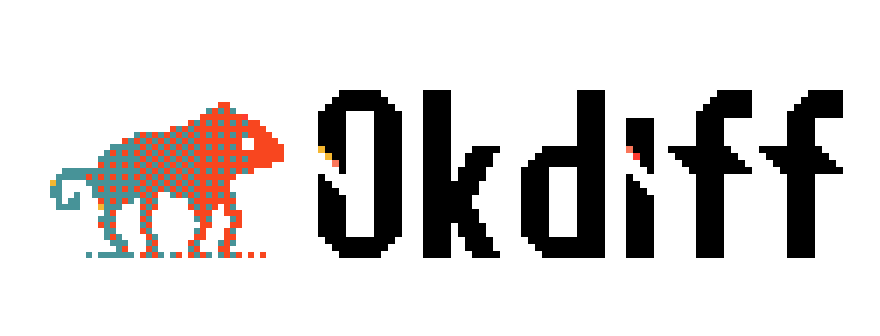
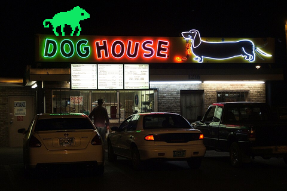
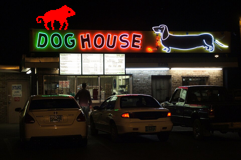
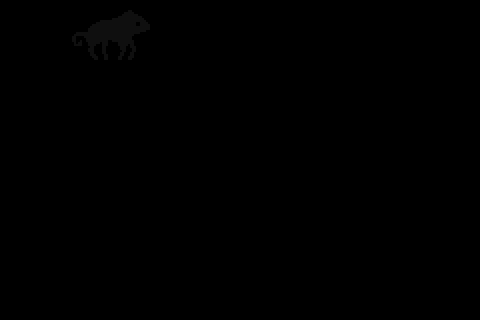
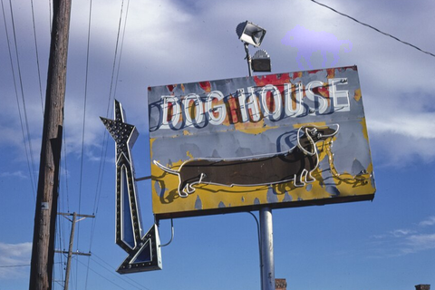
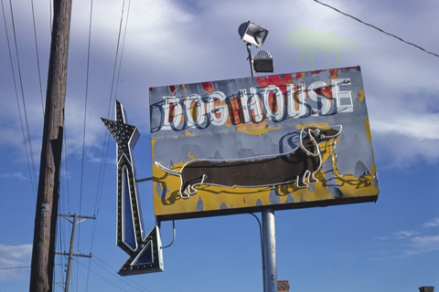
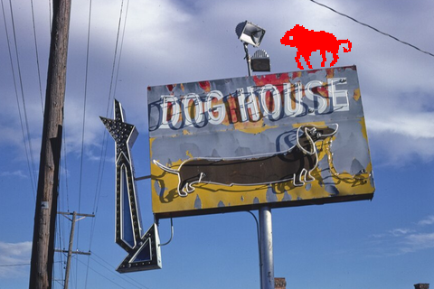
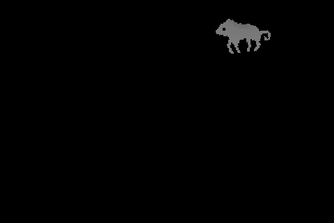

<p align="center">
  <picture>
    <source media="(prefers-color-scheme: dark)" srcset="assets/hero-dark.svg">
    <source media="(prefers-color-scheme: light)" srcset="assets/hero-light.svg">
    
  </picture>
</p>

# okdiff

`okdiff` is a zero-dependency Zig 0.17 SIMD PNG diff and perceptual pixel-measurement CLI for AI agents and visual regression pipelines. Built as an [`Oklab`](https://bottosson.github.io/posts/oklab/) perceptual `deltaE` alternative to [`odiff`](https://github.com/dmtrKovalenko/odiff), it defaults to `--metric oklab` while keeping an `odiff`-compatible `--metric yiq` mode (`35215 * t^2`), eliminating bright-green YIQ false alarms while catching subtle hue shifts and rendering continuous `--delta-map` severity.

| `base` | `comp` | `--metric yiq -t 0.08` | `--metric oklab -t 0.08` | `--delta-map=5.0` |
|:---:|:---:|:---:|:---:|:---:|
|  |  |  |  |  |
|  |  |  |  |  |

## Agent contract

- Exit `0` after measurement even when pixels differ; exit `2` only on usage, I/O, or PNG decode errors. Callers decide verdicts from the emitted counts.
- Pass `--json` for structured single-pair or directory (`--diff-dir`) stats, `--delta-bin <path>` for raw little-endian `f32` delta maps (`u32 w, h` header, `NaN` where unmeasured), or `--server` for stdio NDJSON (`{"base":...,"comp":...}`, `{"command":"close"}`).
- Non-interlaced PNGs (`0/2/3/4/6`, up to 16-bit high byte) alpha-blend onto `#ffffff` before diffing. Run `okdiff --help` for the full CLI surface.

## Build and bindings

Requires Zig 0.17. Zero-dependency TypeScript ([`bindings/okdiff.ts`](bindings/okdiff.ts)) and Python ([`bindings/okdiff.py`](bindings/okdiff.py)) bindings wrap `--json`, `--delta-bin`, and `--server`:

```sh
zig build -Doptimize=ReleaseFast
zig build test
./zig-out/bin/okdiff assets/demo-2-base.png assets/demo-2-comp.png --no-diff-image -t 0.08 --json
# {"stem":"assets/demo-2-base.png","base":{"w":480,"h":320},"comp":{"w":480,"h":320},"identical":151810,"nonidentical":1790,"threshold":0.08,"overThreshold":1790}
node --test bindings/okdiff.test.ts      # TS: import { compare, OkdiffServer } from "./bindings/okdiff.ts"
PYTHONPATH=bindings python -m pytest bindings # Py: from okdiff import compare, OkdiffServer
```

[MIT](LICENSE) · Demo photos adapted from Abq doghouse and Dog house sign LCCN2017709839 (Public domain).
